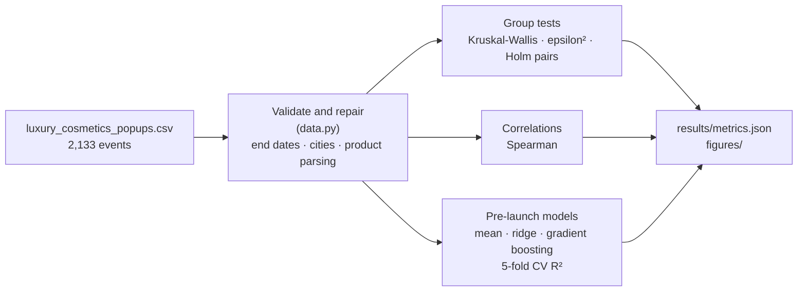
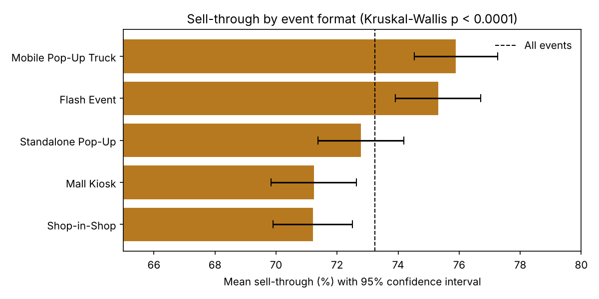

<div align="center">

# Product Launch Marketing Analysis: Luxury Cosmetics Pop-Ups

**An analysis of 2,133 pop-up launch events for 24 luxury beauty brands, testing which planning choices (event format, location, region, product category and price) actually move sell-through, and whether a launch's result can be predicted before it opens.**

[](https://github.com/Collinsthe4th/product-launch-marketing-analysis/actions/workflows/ci.yml)
[](https://www.python.org/)
[](https://scipy.org/)

</div>

---

## Contents

- [About the project](#about-the-project)
- [Pipeline](#pipeline)
- [Tech stack](#tech-stack)
- [Results](#results)
- [Recommendations](#recommendations)
- [Interactive dashboard](#interactive-dashboard)
- [Getting started](#getting-started)
- [Project structure](#project-structure)
- [Limitations](#limitations)

## About the project

Beauty brands use short-term pop-up stores to launch products and test new markets. Each pop-up costs money to lease and staff, so the marketing team wants to know which format and location to choose for the next launch. The data covers 2,133 events between February 2024 and August 2025, across 5 regions and 24 brands such as Dior, Chanel and Fenty Beauty. For each event it records the brand, city, location type, event format, lease length, product, price, average daily footfall, units sold and sell-through (the share of the stock that was sold).

I set out to answer three questions.

1. Which planning choices are linked to higher sell-through?
2. Do more visitors (footfall) and longer leases lead to more units sold?
3. Can sell-through or units sold be predicted before a pop-up opens?

## Pipeline



**Data quality.** There were no duplicate events and every sell-through value was between 0 and 100. 36 events had no end date, so I rebuilt it from the start date and the lease length. This rule matches the given end date for all 2,097 events that have one, so it is safe. 47 events had no city, and I labelled them "Unknown" because the city is not used in the models. I also split each product name into its line and its category (for example "Dior Velvet Lipstick" becomes the line "Velvet" and the category "Lipstick"), which gave 10 product categories.

**Methods.** Sell-through is not normally distributed, so I compared groups with the Kruskal-Wallis test (a rank-based test that does not assume a bell curve). I report epsilon-squared (the share of the variation that the grouping explains) as the effect size, and I corrected the many pairwise comparisons with the Holm method so that I do not find differences by chance. For prediction, I only used information that is known before the pop-up opens, and scored each model with 5-fold cross-validated R² (the share of variation explained on unseen events).

## Tech stack

| Area | Tools |
|---|---|
| Data handling | pandas, NumPy |
| Statistics | SciPy (Kruskal-Wallis, Mann-Whitney, Spearman), Holm correction |
| Modelling | scikit-learn (ridge regression, histogram gradient boosting, cross-validation) |
| Visualisation | Matplotlib |
| Testing | pytest with synthetic data that has a planted effect, GitHub Actions |

## Results

| Planning choice | Kruskal-Wallis p | Effect size (epsilon²) | Conclusion |
|---|---|---|---|
| **Event format** | **< 0.0001** | **0.0145** | Real but small difference |
| Price band | 0.0692 | 0.0019 | No clear difference |
| Location type | 0.2242 | 0.0008 | No difference |
| Region | 0.5984 | 0.0000 | No difference |
| Product category | 0.8386 | 0.0000 | No difference |

Table 1- Sell-through compared across each planning choice.



Fig. 1- Mean sell-through for each event format with 95% confidence intervals. Source: Collins Akagha (2026).

Event format was the only choice with a clear link to sell-through. Mobile pop-up trucks (75.9%) and flash events (75.3%) beat mall kiosks (71.2%) and shop-in-shops (71.2%), a gap of 4.7 percentage points. After the Holm correction, five pairs remained significant, all of them trucks or flash events against kiosks, shop-in-shops or standalone pop-ups. However, the effect size is only 0.0145, which means that the format explains about 1.5% of the variation in sell-through. The rest comes from factors that are not in the data.

The answer to the second question was surprising. The Spearman correlation between daily footfall and units sold was -0.006, and between lease length and units sold it was 0.023. In other words, busier locations and longer leases did not sell more units. I expected both links to be strong, so I checked the parsing and the units, and they are correct. This strongly suggests that the dataset is simulated or that units were capped by the stock sent to each event, which the data does not record.

| Target | Mean (baseline) R² | Ridge R² | Gradient boosting R² |
|---|---|---|---|
| Sell-through | -0.004 | 0.005 | -0.041 |
| Units sold | -0.002 | -0.003 | -0.049 |
| Revenue | -0.001 | 0.514 | 0.462 |

Table 2- Cross-validated R² when predicting each outcome from pre-launch information only.

Neither sell-through nor units sold can be predicted before launch. The best model explained 0.5% of the variation in sell-through, which is no better than guessing the average. Revenue looks predictable (R² of 0.514), but only because revenue is price × units and the price is one of the inputs. The model is learning the price, not the demand.

## Recommendations

1. **Prefer mobile trucks and flash events for launches.** They are the only lever with a significant effect, and the 4.7-point gain in sell-through is worth having on fast-moving stock. Revenue per lease day did not differ by format (p = 0.49), so this choice does not cost revenue.
2. **Do not pay a premium for a "better" region or location type.** None of them changed sell-through in this data.
3. **Collect the missing drivers before building a forecasting model.** Stock allocated per event, marketing spend and conversion at the door are the likely drivers, and none of them are recorded. Until they are, a planned A/B test of formats (similar to my [landing page experiment](https://github.com/Collinsthe4th/ab-testing-web-feature)) is a better guide than a model.

## Interactive dashboard

The Streamlit app (`streamlit_app.py`) lets you filter the events by region and brand and compare sell-through by any planning choice. The statistical test and effect size update for the selected events. It also shows the footfall check and the pre-launch model results.

```bash
streamlit run streamlit_app.py
```

## Getting started

```bash
git clone https://github.com/Collinsthe4th/product-launch-marketing-analysis.git
cd product-launch-marketing-analysis
python -m venv .venv && source .venv/bin/activate   # Windows: .venv\Scripts\activate
pip install -r requirements.txt

python scripts/run_analysis.py    # writes results/metrics.json and both figures
python -m pytest -q
```

## Project structure

```
product-launch-marketing-analysis/
├── data/raw/luxury_cosmetics_popups.csv
├── src/popup_analysis/
│   ├── data.py          # validation, date repair, product parsing, revenue
│   └── analysis.py      # group tests, Holm correction, pre-launch models
├── scripts/run_analysis.py
├── results/             # metrics.json and figures/
└── tests/               # tests on synthetic data with a planted effect
```

## Limitations

The data has no stock levels, costs or marketing spend, so I could not measure profit or return on investment. The missing link between footfall and units also means that this data may not behave like real retail data, so the size of the format effect should be confirmed with a real experiment before it guides a large budget. Finally, events were not assigned to formats at random, so the format difference shows an association and not proof of cause.

In conclusion, the event format was the only planning choice that mattered, and even it explained only 1.5% of the variation. The most useful result of this analysis is negative but important: the current data cannot forecast a launch, and better data collection should come before more modelling.
